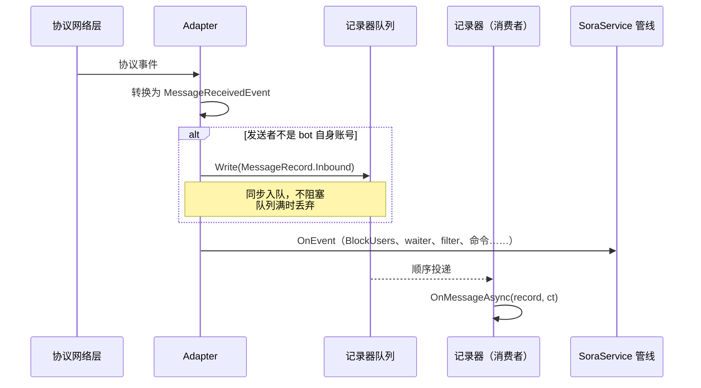
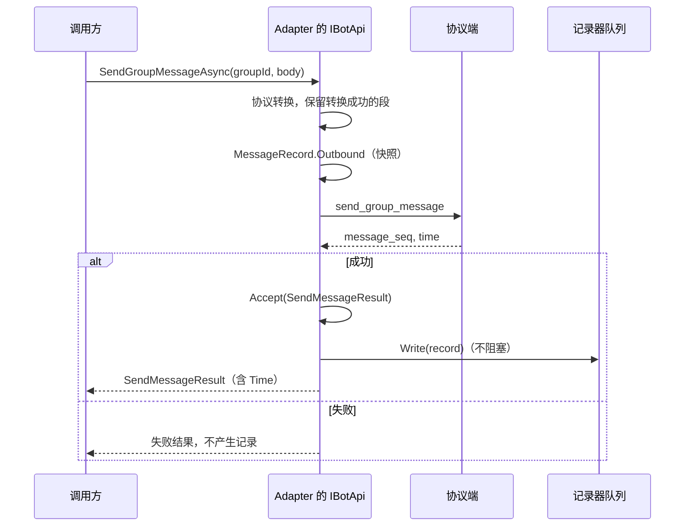
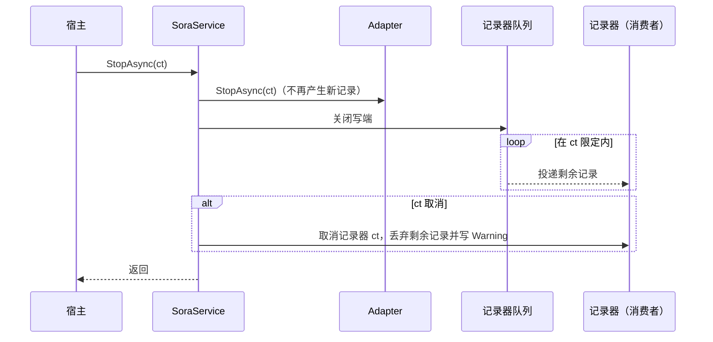

# 消息记录

消息记录是 Sora 的一项基础设施功能，用于留存 bot 收发的全部聊天消息，例如满足业务方的聊天存档要求。它是事件管线之外的只读旁路：记录器拿不到 `IBotApi`，不能阻断或改变事件处理，也永远不会阻塞或拖慢业务执行。

## 记录范围

| 方向 | 记录 | 不记录 |
|------|------|--------|
| 接收（`Inbound`） | adapter 收到的全部聊天消息（`MessageReceivedEvent`），包括之后被 BlockUsers 丢弃、被连续对话 waiter 消费、被 filter 拦截的消息 | bot 自身账号发出的消息；adapter 无法转换而丢弃的事件；通知类事件 |
| 发送（`Outbound`） | 通过 adapter 发送 API 成功提交给协议端的全部消息，不区分调用方（业务 handler、命令重入提示等） | 协议返回失败或抛出异常的发送；非发消息的 API 调用 |

bot 自身账号的消息只以发送方向出现。即使设置 `DropSelfMessage = false` 让协议回推自身消息，这些回推也不会产生接收记录；不经过 Sora 发出的自身消息（例如在其他客户端登录同一账号发送）不会被记录。

## 接入

```csharp
using Sora.Entities.Recording;

public sealed class ChatArchive : IMessageRecorder
{
    public async ValueTask OnMessageAsync(MessageRecord record, CancellationToken ct)
    {
        // 写入数据库、文件等；ct 在服务放弃排空队列时取消
        await SaveAsync(record, ct);
    }
}

SoraService service = SoraServiceFactory.Instance.CreateMilkyService(config);
service.UseMessageRecorder(new ChatArchive());
// 写入较慢的记录器可以加大队列容量，减少高峰期丢弃
service.UseMessageRecorder(new SlowArchive(), new MessageRecorderOptions { Capacity = 16384 });
await service.StartAsync();
```

- `UseMessageRecorder` 必须在 `StartAsync` 之前调用，之后调用抛出 `InvalidOperationException`；`Capacity` 不为正数时抛出 `ArgumentOutOfRangeException`。
- 可以注册多个记录器，每个记录器有自己的队列和选项。
- 同一个记录器实例注册到多个 service 时会被并发调用，必须线程安全；只注册到一个 service 时不会被并发调用。

## MessageRecord

收、发共用 `MessageRecord`，所有属性只读，使用方无法构造或修改。

| 属性 | 接收 | 发送 |
|------|------|------|
| `Direction` | `Inbound` | `Outbound` |
| `ProtocolName`、`ConnectionId`、`SelfId` | 产生记录的 adapter、连接与 bot 账号 | 同左 |
| `Time` | 协议的消息时间 | 协议返回的发送时间；协议未返回时为收到成功响应时的本地时间 |
| `MessageId`、`SourceType`、`GroupId` | 协议消息 ID、来源类型、群号 | 同左 |
| `PeerUserId` | 私聊/临时会话的对方（发送者） | 私聊的对方（接收者） |
| `SenderId`、`SenderName` | 发送者 | `SenderId` 等于 `SelfId` |
| `Segments` | 收到的消息段 | 实际提交给协议端的消息段 |
| `Sender`、`Group`、`Member` | 发送者、群、群成员信息 | null |

记录中的消息段是独立副本：之后对原 `MessageBody` 或其中消息段的任何修改都不影响已产生的记录。发送方向记录的是发送入口 `ToOutgoing()` 转换之后、协议转换成功的段；无法发送或协议端不支持而被丢弃的段不出现在记录中。

转发消息在记录中表示为 `ForwardRecordSegment`，内层每条消息本身是一条 `MessageRecord`（`SenderId`、`SenderName`、`Time`、`Segments`，方向与外层相同），完整保留内层内容，记录中不出现 `MessageBody`。`ForwardRecordSegment.ToOutgoing()` 返回 null，不能再次发送：放进 `MessageBody` 后会在发送时被丢弃。接收方向的转发通常只有 `ForwardId`，`Messages` 为空。

`ForwardRecordSegment.Direction` 默认是 `Incoming`：接收记录中的转发都来自协议。只有用户构建并发出的转发（即发送记录中的转发，包括嵌套转发）是 `Outgoing`，因为收到的转发只有 `ForwardId`，无法再次发送。

## 队列与顺序

每个记录器拥有一个有界队列和一个运行在线程池上的单消费者。adapter 只做一次同步、非阻塞的入队，记录器代码只在消费者中执行，即使记录器同步阻塞也不会占用 adapter 的收发线程。

- 默认容量为 4096，可通过 `MessageRecorderOptions.Capacity` 按记录器设置。
- 队列满时丢弃新记录，并写限流的 Warning（每个记录器每 10 秒最多一条，附带丢弃数量）。记录器再慢也不影响业务，也不影响其他记录器；对丢失敏感的场景应加大容量并让记录器尽快返回（例如先写入本地缓冲再异步落库）。
- 单个记录器按入队顺序收到记录：接收记录按 adapter 推入的顺序，发送记录按成功响应返回的顺序。框架不按协议时间重新排序。
- 接收记录在事件分发前入队，早于 BlockUsers、waiter、filter 和命令。
- 记录器抛出的普通异常写 Error 日志后跳过该条，继续投递后续记录。记录器因服务传入的 `ct` 取消而抛出的取消异常不记录为错误。

## 时序

### 接收



### 发送



### 停止



`StopAsync` 在调用方 `ct` 限定的时间内尽量排空队列；未传入 `ct`（包括 `DisposeAsync`）时等待全部记录投递完成。排空被取消时 `StopAsync` 正常返回，不抛出取消异常。adapter 停止失败时队列仍会排空，adapter 的异常照常抛出。

服务重新启动时会创建新的队列。如果上一次停止放弃了排空、而某个记录器忽略了 `ct` 仍在执行，`StartAsync` 会写 Warning 并在调用方 `ct` 限定内等待它结束，之后才开始新的投递，保证同一记录器不会被并发调用；`ct` 取消时 `StartAsync` 抛出取消异常。

## Adapter 支持

上报义务由 adapter 承担，并通过 `IBotAdapter` 的 internal 成员强制要求。Milky 已实现；冻结的 OB11 适配器不支持消息记录。第三方 adapter 的接入要求见 [Adapter 开发指南](ADAPTER-DEVELOPMENT.md#消息记录义务)。

[返回 README](../README.md)
